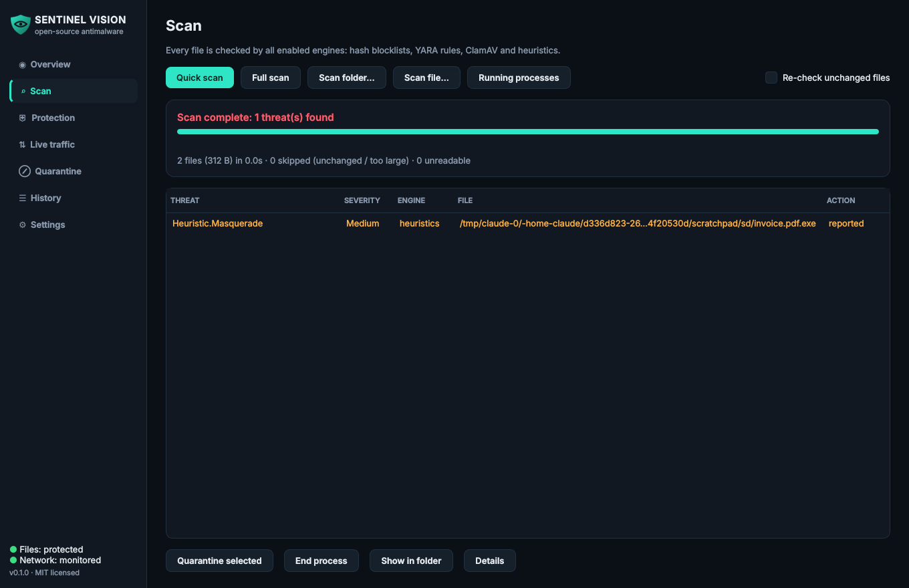

<p align="center">
  
</p>

<h1 align="center">Sentinel Vision</h1>

<p align="center">
  <b>Open-source, multi-engine antimalware with real-time protection and live network monitoring.</b><br>
  Windows · macOS · Linux — MIT licensed — no telemetry, no account, no cloud upload of your files.
</p>

<p align="center">
  <a href="https://github.com/dylanckoldan-boop/sentinel-vision/actions/workflows/ci.yml"></a>
  
  
</p>

---

## What it does

| | |
|---|---|
| **4 detection engines** | Hash blocklists (MD5/SHA-1/SHA-256) · YARA (bundled rules + [YARA Forge](https://yarahq.github.io/) + your own) · ClamAV (via `clamd` or `clamscan`) · static heuristics for unknown threats |
| **Real-time protection** | Watches Downloads, Desktop, Documents, temp and autostart folders; new or changed files are scanned the moment they finish writing and known malware is quarantined automatically |
| **Live traffic monitor** | Every TCP/UDP connection mapped to its process, checked against botnet-C2 and criminal-netblock feeds, with a live throughput graph, alerts, *End process*, *Block IP* (OS firewall) and reputation lookup |
| **Process scanning** | Scans the executable behind every running process |
| **Archive inspection** | Looks inside zip / tar / gz / bz2 / xz (nested) with zip-bomb limits |
| **Encrypted quarantine** | AES-256-GCM vault with chunk-level integrity; restores are hash-verified |
| **Auto-updating intel** | YARA Forge, MalwareBazaar, Feodo Tracker, ThreatFox, Spamhaus DROP, Emerging Threats, CINS (optional), and `freshclam` |
| **GUI + CLI + daemon** | PySide6 desktop app with tray icon & notifications; a scriptable CLI with JSON output and exit codes; a headless daemon for servers |

<p align="center">
  
  
</p>

## Install

Requires Python 3.10+.

```bash
git clone https://github.com/dylanckoldan-boop/sentinel-vision
cd sentinel-vision
python -m venv .venv
# Windows: .venv\Scripts\activate     macOS/Linux: source .venv/bin/activate
pip install .
sentinel-vision          # launch the GUI
```

Then open **Settings & updates → Update now** to download the community rule sets and threat feeds (this also happens automatically every 6 hours).

### Strongly recommended: add ClamAV

ClamAV adds millions of signatures. Sentinel Vision uses it automatically when it is installed:

| OS | Install |
|---|---|
| Windows | Download the installer from [clamav.net/downloads](https://www.clamav.net/downloads), then run `freshclam` once |
| macOS | `brew install clamav` (then copy `freshclam.conf.sample` → `freshclam.conf`, remove the `Example` line, run `freshclam`) |
| Debian/Ubuntu | `sudo apt install clamav clamav-daemon && sudo systemctl enable --now clamav-daemon` |
| Fedora | `sudo dnf install clamav clamd clamav-update && sudo freshclam` |

Running the `clamd` daemon makes ClamAV scans ~100× faster than `clamscan` because signatures stay loaded.

### Optional: MalwareBazaar hash feed

Get a free Auth-Key at [auth.abuse.ch](https://auth.abuse.ch/) and paste it into **Settings → abuse.ch Auth-Key**. This adds thousands of fresh malware hashes every day.

## Command line

```bash
sentinel-vision-cli status                      # engine and definition status
sentinel-vision-cli update                      # download the latest definitions
sentinel-vision-cli scan ~/Downloads /mnt/usb   # scan paths (auto-quarantines signature hits)
sentinel-vision-cli scan . --no-quarantine --json > report.json
sentinel-vision-cli quick                       # quick scan + running processes
sentinel-vision-cli processes                   # scan running programs only
sentinel-vision-cli net --watch                 # live connection table in the terminal
sentinel-vision-cli quarantine list
sentinel-vision-cli quarantine restore <ID> --to ~/restored
sentinel-vision-cli daemon                      # headless real-time + network protection
```

Exit codes: `0` clean · `1` threats found · `2` error — handy for CI pipelines and cron jobs.

## How detection works

```
file ─┬─► SHA-256 / SHA-1 / MD5 ──► hash blocklist ─────────┐  signature hits
      ├─► YARA (thread-local compiled rule set) ────────────┤  → auto-quarantine
      ├─► ClamAV (clamd INSTREAM, or clamscan) ─────────────┘
      ├─► heuristics: PE structure, packers, section entropy, injection/keylogger/ransomware
      │   import combos, script cradles, AMSI/Defender tampering, macro auto-exec, LNK
      │   launchers, double extensions, RTLO tricks, miner and ransom-note strings
      │   → score 0-100, reported at ≥ threshold (report-only unless you opt in)
      └─► archives are unpacked in memory (depth / size / ratio limits) and every
          member goes through the same pipeline
```

Clean results are cached by path + size + mtime and invalidated whenever definitions change, so repeat scans only touch new or modified files.

## Security design

Security software is a high-value target, so Sentinel Vision is built defensively:

* **Never executes what it scans.** Files are only read; `pefile`, `zipfile` and `tarfile` parse in memory and archive members are never written to disk.
* **Hardened parsing.** Size caps, member-count caps, compression-ratio (zip-bomb) checks, YARA match timeouts, and every engine runs inside its own error boundary so a malformed file can't stop a scan.
* **Safe updates.** HTTPS only (TLS 1.2+, certificate verification always on, HTTPS-only redirects), download size limits, YARA archives are extracted file-by-file with flattened names (no path traversal), and new rules are compile-checked then swapped in atomically — a bad update never removes working protection.
* **Encrypted quarantine.** AES-256-GCM with a per-install key stored owner-only; per-chunk nonces and authenticated position/final-chunk flags detect tampering, reordering and truncation; restores are verified against the original SHA-256 and never overwrite existing files.
* **No shell, ever.** External tools (`netsh`, `iptables`, `clamscan`, `freshclam`) are called with argument lists; IPs are validated before any firewall rule is built; private/loopback addresses can't be blocked.
* **Private by default.** No telemetry. Your files never leave your machine — only hash/IP feeds are downloaded. Data lives in an owner-only directory (`platformdirs` user data dir, or `$SENTINEL_VISION_HOME`).
* **Self-protection from false positives.** The app's own install and data directories are excluded so its signature files are never "detected".

Found a vulnerability? Please see [SECURITY.md](SECURITY.md).

## Honest limitations

Sentinel Vision is a strong second opinion and a transparent, hackable security toolkit. It is **not** a drop-in replacement for an OS-integrated antivirus:

* Real-time protection reacts **when a file is written**, not when it is opened. Blocking a file *before* it can execute requires a kernel driver / OS security API (Windows minifilter + AMSI, macOS Endpoint Security, Linux fanotify) — contributions welcome. Keep Microsoft Defender / XProtect enabled alongside it.
* No behavioural (runtime) monitoring of process actions yet.
* Per-process bandwidth isn't available portably; the graph shows system-wide throughput.
* On macOS, seeing every process's connections requires running with elevated privileges.
* Detection quality depends on the feeds and rules you enable — update regularly.

## Data locations

| | |
|---|---|
| Windows | `%LOCALAPPDATA%\SentinelVision` |
| macOS | `~/Library/Application Support/SentinelVision` |
| Linux | `~/.local/share/SentinelVision` |

Inside: `settings.json`, `sentinel.db` (hashes, history, cache), `quarantine/`, `rules/downloaded/`, `rules/custom/` (drop your own `.yar` files here), `feeds/`, `logs/`.

## Building standalone apps

Tagged releases are built automatically for Windows, macOS and Linux by [`.github/workflows/release.yml`](.github/workflows/release.yml) using PyInstaller. To build locally:

```bash
pip install . pyinstaller
pyinstaller packaging/sentinel_vision.spec
```

## Development

```bash
pip install -e ".[dev]"
pytest                 # 39 tests: engines, quarantine crypto, archives, intel, realtime, CLI, GUI smoke
ruff check src tests
```

Project layout:

```
src/sentinel_vision/
  engines/      hash, YARA, ClamAV and heuristic engines
  network/      live connection monitor, threat-intel store, firewall integration
  gui/          PySide6 application (pages, widgets, theme)
  rules/        bundled YARA rules
  scanner.py    scan orchestration, archive handling, actions
  realtime.py   file-system watcher
  quarantine.py encrypted vault
  updater.py    signature / feed updater
  cli.py        command-line interface
```

See [CONTRIBUTING.md](CONTRIBUTING.md) — rule contributions, new feeds and OS-level on-access blocking are especially welcome.

## Credits

Detection content comes from the security community: [YARA](https://virustotal.github.io/yara/), [YARA Forge](https://github.com/YARAHQ/yara-forge) and the rule authors it aggregates, [ClamAV](https://www.clamav.net/), [abuse.ch](https://abuse.ch/) (MalwareBazaar, Feodo Tracker, ThreatFox), [Spamhaus](https://www.spamhaus.org/drop/), [Proofpoint Emerging Threats](https://rules.emergingthreats.net/) and [CINS Army](https://cinsscore.com/). Downloaded rule sets and feeds remain under their own licenses and terms of use.

## License

[MIT](LICENSE) © 2026 Dylan Koldan
