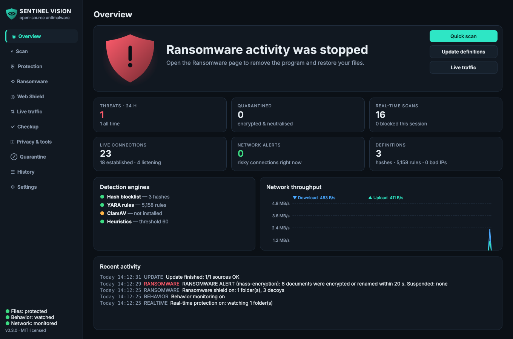
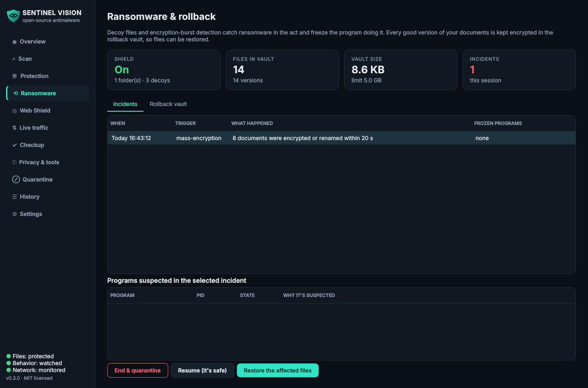
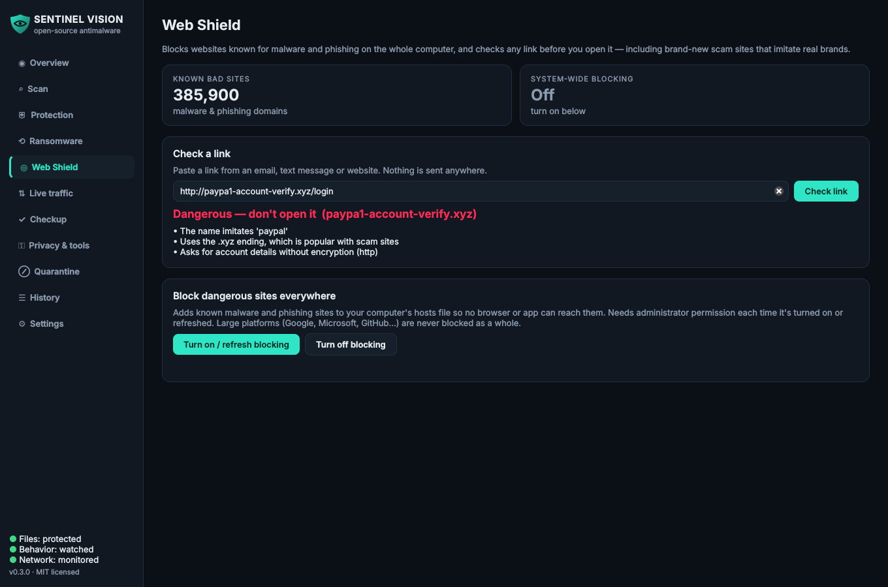
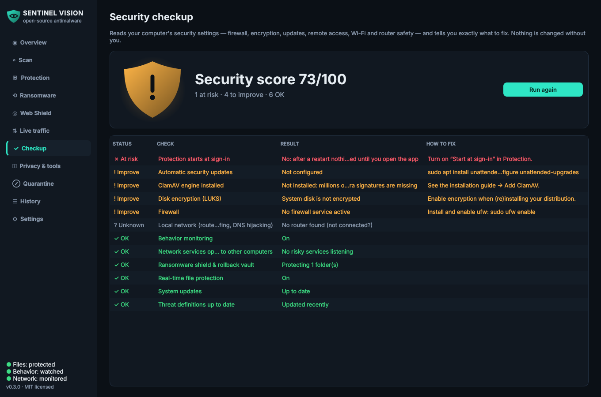
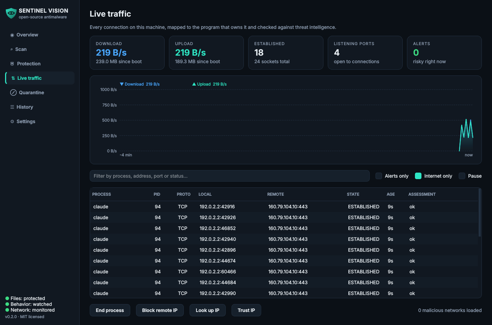
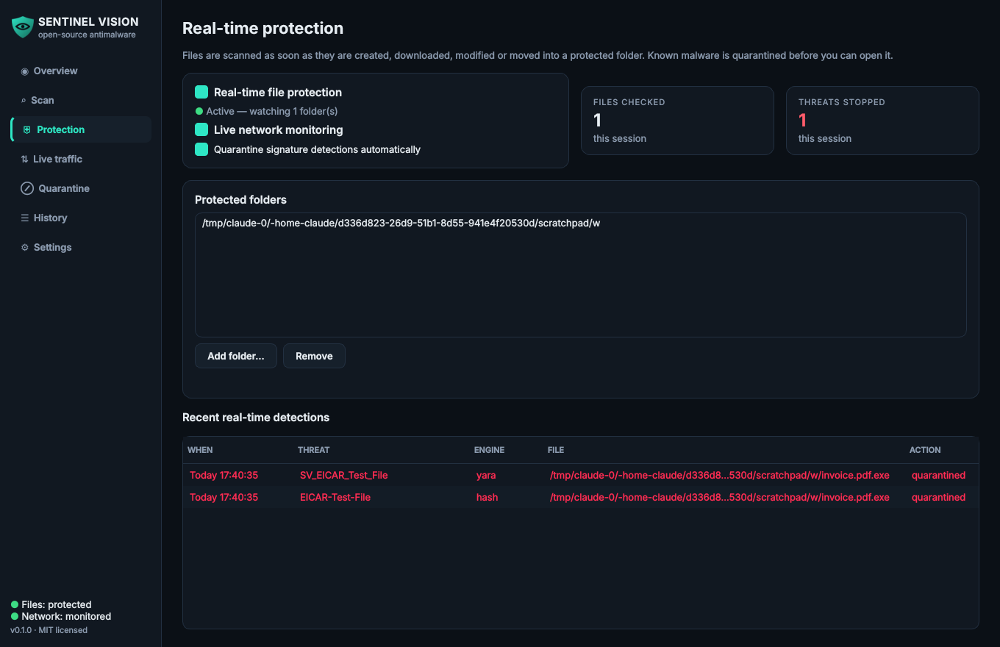
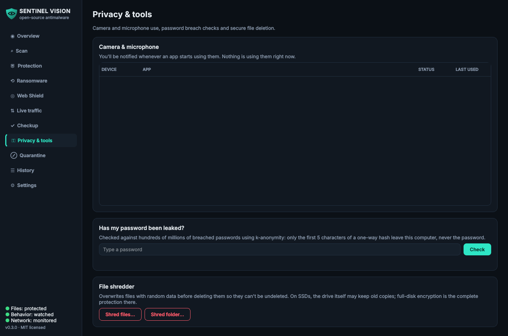

<p align="center">
  
</p>

<h1 align="center">Sentinel Vision</h1>

<p align="center">
  <b>Free, open-source antimalware with ransomware rollback, web protection, behavior monitoring, live network monitoring and post-quantum signed updates.</b><br>
  Windows · macOS · Linux — MIT licensed — no telemetry, no account, no cloud upload of your files.
</p>

<p align="center">
  <a href="https://github.com/dylanckoldan-boop/sentinel-vision/releases/latest"></a>
  <a href="https://github.com/dylanckoldan-boop/sentinel-vision/actions/workflows/ci.yml"></a>
  
  
</p>

<p align="center">
  <a href="https://github.com/dylanckoldan-boop/sentinel-vision/releases/latest"><b>⬇ Download</b></a> ·
  <a href="https://dylanckoldan-boop.github.io/sentinel-vision/">Website</a> ·
  <a href="docs/INSTALL.md">Installation guide</a> ·
  <a href="docs/COMPARISON.md">vs Norton &amp; McAfee</a> ·
  <a href="ROADMAP.md">Roadmap</a> ·
  <a href="CHANGELOG.md">Changelog</a> ·
  <a href="https://dylanckoldan-boop.github.io/sentinel-vision/privacy.html">Privacy</a>
</p>

---

## Install

### Windows (recommended: the installer)

1. Download **`SentinelVision-<version>-Setup.exe`** from the [latest release](https://github.com/dylanckoldan-boop/sentinel-vision/releases/latest).
2. Run it. If Windows shows *"Windows protected your PC"*, click **More info → Run anyway** (the app isn't code-signed yet — [why](docs/CODE_SIGNING.md)).
3. Keep **"Start Sentinel Vision when I sign in and restart it if it is closed"** ticked and click **Install**.
   Windows asks for administrator permission once: Sentinel Vision installs into **Program Files**, where other programs
   can't change it, together with the **Sentinel Vision Protection** service that guards its data and settings.
4. In the app, open **Settings & updates → Update now** to download the latest threat definitions.

That's it — Sentinel Vision now starts hidden in the system tray every time you sign in, and updates itself.
Upgrading from 0.3.x (installed in your own folder) moves everything to Program Files automatically and keeps your
settings, quarantine and rollback vault — see [the upgrade notes](docs/INSTALL.md#upgrading-from-03x).

### macOS, Linux, portable and from source

See the **[installation guide](docs/INSTALL.md)** for step-by-step instructions for every platform, ClamAV setup,
updating, uninstalling and troubleshooting.

## What it does

| | |
|---|---|
| **4 detection engines** | Hash blocklists (MD5/SHA-1/SHA-256) · YARA (bundled rules + [YARA Forge](https://yarahq.github.io/) + your own) · ClamAV (via `clamd` or `clamscan`) · static heuristics for unknown threats, with Windows Authenticode and catalog-signature checks to avoid false alarms on signed software |
| **Calm, honest results** | Threats are separated from *items to review* (machine-generated rule hints, dual-use tools, findings in installed programs' folders). Automatic quarantine only for exact known-malware matches, or strong matches on programs in your own folders — never caches, app databases or installed software. Audited weekly against everyday Windows apps (Steam, Office, Adobe Reader, VLC, …). |
| **Tamper protection (Windows)** | The *Sentinel Vision Protection* service keeps the rollback vault, quarantine and protection settings in a folder only Windows and administrators can open. Other programs can't delete them, and turning protection off, adding exclusions or quitting needs your administrator approval. It restarts the app if something closes it, and tells you. |
| **Real-time protection** | Watches Downloads, Desktop, Documents, temp and autostart folders; new or changed files are scanned the moment they finish writing and known malware is quarantined automatically |
| **Behavior monitoring** | Every new program is checked for attack techniques (malicious-document shells, download-and-run PowerShell, ransomware deleting backups, LOLBin abuse, reverse shells, miners) and its executable is scanned; confirmed malware is ended and quarantined. Auto-start locations are watched for new persistence. |
| **Ransomware shield & rollback** | Hidden decoy files plus fast *and* slow encryption detection — including ransomware that leaves the start of each file intact — catch ransomware in the act and freeze the program responsible; every good version of your documents is kept in an encrypted vault so you can roll back to before the attack |
| **Web Shield & firewall** | Hundreds of thousands of malware and phishing domains, blocked system-wide for every browser and app (optional), plus a local link checker that catches look-alike brands and homograph tricks. On Windows, known criminal networks (Spamhaus DROP, Feodo Tracker, Emerging Threats) are blocked in Windows Firewall by the protection service. |
| **Security checkup** | A score for your computer's settings — firewall, encryption, updates, outdated apps, Remote Desktop, SMBv1, Secure Boot, Wi-Fi — with exact fixes; plus router-spoofing (ARP) and DNS-hijack detection |
| **Memory scan** | Finds fileless malware in the memory of running programs — on demand and with every weekly full scan |
| **Privacy & tools** | Camera/microphone use alerts, password breach check (k-anonymity: the password never leaves your device), file shredder, quiet mode |
| **USB & schedules** | USB drives scanned the moment they're connected; daily quick and weekly full scans |
| **Live traffic monitor** | Every TCP/UDP connection mapped to its process, checked against botnet-C2 and criminal-netblock feeds, with a live throughput graph, alerts, *End process*, *Block IP* (OS firewall) and reputation lookup |
| **Starts at sign-in** | Runs quietly in the tray from the moment you log in (Windows, macOS and Linux) |
| **Self-updating, post-quantum signed** | Threat definitions every 6 hours; the app itself through installers verified with a hybrid **ML-DSA-65 + Ed25519** signature (quantum-resistant) and downgrade protection |
| **Process & archive scanning** | Scans the executable behind every running process; looks inside zip / tar / gz / bz2 / xz (nested) with decompression-bomb protection |
| **Encrypted quarantine** | AES-256-GCM vault with chunk-level integrity; restores are hash-verified |
| **GUI + CLI + daemon** | Desktop app with tray icon & notifications; scriptable CLI with JSON output and exit codes; headless daemon for servers |

<p align="center">
  
  
  
  
  
  
</p>

**How does it compare with Norton and McAfee?** See the [source-backed comparison](docs/COMPARISON.md).

## Command line

Included with every install (`sentinel-vision-cli`; on Windows tick *Add to PATH* in the installer or run it from the install folder):

```bash
sentinel-vision-cli status                      # engines, definitions, start-at-sign-in
sentinel-vision-cli update                      # download the latest definitions
sentinel-vision-cli scan ~/Downloads /mnt/usb   # scan paths (auto-quarantines signature hits)
sentinel-vision-cli scan . --no-quarantine --json > report.json
sentinel-vision-cli quick                       # quick scan + running processes
sentinel-vision-cli processes                   # scan running programs only
sentinel-vision-cli net --watch                 # live connection table in the terminal
sentinel-vision-cli quarantine list
sentinel-vision-cli quarantine restore <ID> --to ~/restored
sentinel-vision-cli autostart on|off|status     # start the app at sign-in
sentinel-vision-cli check-update                # is a newer version available?
sentinel-vision-cli checkup                     # security checkup with score
sentinel-vision-cli memscan                     # scan program memory for fileless malware
sentinel-vision-cli rollback since "2026-10-11 09:00"   # undo everything changed after that time
sentinel-vision-cli webshield check https://example.com/login
sentinel-vision-cli webshield enable            # block malware/phishing sites system-wide (asks for admin)
sentinel-vision-cli password-check              # was this password in a data breach?
sentinel-vision-cli shred secret.pdf            # securely delete
sentinel-vision-cli daemon                      # headless real-time + behavior + ransomware + network protection
```

Exit codes: `0` clean · `1` threats found · `2` error — handy for CI pipelines and cron jobs.

## How detection works

```
file ─┬─► SHA-256 / SHA-1 / MD5 ──► hash blocklist ─────────┐  signature hits
      ├─► YARA (thread-local compiled rule set) ────────────┤  → auto-quarantine
      ├─► ClamAV (clamd INSTREAM, or clamscan) ─────────────┘
      ├─► heuristics: PE structure, packers, section entropy, injection/keylogger/ransomware
      │   import combos, script cradles, AMSI/Defender tampering, macro auto-exec, LNK
      │   launchers, double extensions, RTLO tricks, miner and ransom-note strings;
      │   valid Authenticode signatures lower the score, broken ones raise it
      │   → score 0-100, reported at ≥ threshold (report-only unless you opt in)
      └─► archives are unpacked in memory (count / size / bomb limits) and every
          member goes through the same pipeline

new process ─► technique rules (parent, command line, location) ─► report / end ransomware tools
            └► executable scanned by all engines ─► confirmed malware ended + quarantined
auto-start entry added ─► reported, target scanned
```

Clean results are cached by path + size + mtime and invalidated whenever definitions change, so repeat scans only
touch new or modified files. A weekly [false-positive audit](.github/workflows/fp-audit.yml) scans 20,000 clean system and
application files on each of Windows, macOS and Linux with every engine and fails if anything would be removed.

## Security design

Security software is a high-value target, so Sentinel Vision is built defensively:

* **Never executes what it scans.** Files are only read; `pefile`, `zipfile` and `tarfile` parse in memory and archive members are never written to disk.
* **Hardened parsing.** Size caps, member-count caps, decompression-bomb checks, YARA match timeouts, and every engine runs inside its own error boundary so a malformed file can't stop a scan.
* **Safe updates.** HTTPS only (TLS 1.2+, certificate verification always on, HTTPS-only redirects), download size limits, YARA archives are extracted file-by-file with flattened names (no path traversal), and new rules are compile-checked then swapped in atomically — a bad update never removes working protection. App updates are verified against the release's SHA-256 checksums before they run.
* **Encrypted quarantine.** AES-256-GCM with a per-install key stored owner-only; per-chunk nonces and authenticated position/final-chunk flags detect tampering, reordering and truncation; restores are verified against the original SHA-256 and never overwrite existing files.
* **Post-quantum signed updates.** Release checksums are signed with ML-DSA-65 (NIST FIPS 204) and Ed25519; both must verify, and the app refuses unsigned or older installers. Stored data uses AES-256-GCM, which keeps 128-bit security even against quantum computers. Details in [the comparison](docs/COMPARISON.md#post-quantum-design).
* **Careful automatic actions.** Only signature-confirmed malware and the actual backup-deletion tools are ended automatically; heuristic and technique alerts are report-only by default. Pattern matches on validly signed programs, caches and app databases, installed programs' folders, and anything short of an exact match on operating-system files, are reported rather than removed.
* **Tamper protection (Windows).** Installed in Program Files (only administrators can change it). The protection service (LocalSystem) keeps each account's vault, quarantine and protection settings in a folder with a protected SYSTEM/Administrators-only ACL that it re-checks (and refuses to follow links in) at every start; each account only reaches its own data; the service only stores and returns bytes and never writes into users' folders; weakening changes need an elevated caller; its named pipe rejects remote clients, and the app only talks to a pipe owned by a Windows service (session 0). Machine-wide blocking uses lists the service downloads itself, never lists supplied by other programs.
* **No shell, ever.** External tools (`netsh`, `iptables`, `clamscan`, `freshclam`, `taskkill`) are called with argument lists; IPs are validated before any firewall rule is built; private/loopback addresses can't be blocked.
* **Private by default.** No telemetry. Your files never leave your machine — only hash/IP feeds and update metadata are downloaded. Data lives in an owner-only directory.
* **Self-protection from false positives.** The app's own install and data directories are excluded so its signature files are never "detected".

Found a vulnerability? Please report it privately — see [SECURITY.md](SECURITY.md).

## Honest limitations

Sentinel Vision is a strong second layer and a transparent, hackable security toolkit. It is **not** a drop-in
replacement for an OS-integrated antivirus — keep Microsoft Defender / XProtect enabled alongside it:

* Files are checked **when they are written** and programs **right after they start** (within about a second), not
  *before* they open. Ransomware is stopped by decoys and burst detection within seconds, and files it touched can be rolled back. Blocking first requires OS-level hooks that need vendor approval (Windows minifilter drivers,
  macOS Endpoint Security) or root (Linux fanotify — on the [roadmap](ROADMAP.md)).
* Builds are not yet code-signed, so Windows and macOS show a warning on first launch ([how to fix that](docs/CODE_SIGNING.md)).
* Tamper protection stops malware running with **your** rights. Malware that already has administrator rights can still
  stop the service — only kernel-level protection (which needs Microsoft's signature) prevents that. On macOS and
  Linux there is no protection service yet: data and settings live in your own folder.
* Network throughput is system-wide; per-process bandwidth isn't available portably yet.
* System-wide website blocking uses the hosts file and blocks whole host names (not individual pages). Browsers set to their own "secure DNS only" mode can skip it — the Security checkup tells you if one is.
* The rollback vault lives on the same disk as your documents. On Windows other programs can't reach it, but a disk failure or ransomware with administrator rights could still destroy it. Keep an offline/cloud backup too.
* On macOS, scanning protected folders needs Full Disk Access and seeing every process's connections needs admin rights.
* Detection quality depends on the feeds and rules you enable — keep definitions updated and add ClamAV.

## Data locations

| | |
|---|---|
| Windows | `%LOCALAPPDATA%\SentinelVision` (vault, quarantine and protected settings: `%ProgramData%\SentinelVision\Service`, administrators only) |
| macOS | `~/Library/Application Support/SentinelVision` |
| Linux | `~/.local/share/SentinelVision` |

Inside: `settings.json`, `sentinel.db` (hashes, history, cache), `quarantine/`, `vault/` (rollback copies), `webshield.db`, `rules/downloaded/`, `rules/custom/`
(drop your own `.yar` files here), `feeds/`, `logs/`.

## Development

```bash
git clone https://github.com/dylanckoldan-boop/sentinel-vision && cd sentinel-vision
pip install -e ".[dev]"
pytest                 # 130+ tests: engines, crypto, ransomware, web shield, checkup, updates, CLI, GUI
ruff check src tests tools
```

```
src/sentinel_vision/
  engines/      hash, YARA, ClamAV, heuristic engines + Authenticode verification
  network/      live connection monitor, threat-intel store, firewall integration
  gui/          PySide6 application (pages, widgets, theme)
  rules/        bundled YARA rules
  scanner.py    scan orchestration, archive handling, actions
  realtime.py   file-system watcher
  behavior.py   process and persistence monitoring
  quarantine.py encrypted quarantine
  ransomware.py decoys, encryption-burst detection, culprit freezing
  vault.py      encrypted versioned rollback vault
  webshield.py  domain intelligence, hosts-file blocking, link checker
  advisor.py    security checkup, router-spoofing / DNS-hijack guard
  memscan.py    process memory scanning
  devices.py    USB drives, schedules, camera/mic monitor, shredder
  reputation.py cloud hash lookups, password breach check
  pqsign.py     hybrid ML-DSA-65 + Ed25519 signatures (trust.py: pinned keys)
  updater.py    signature / feed updater
  app_update.py application self-update
  autostart.py  start at sign-in
  cli.py        command-line interface
packaging/      PyInstaller spec, icons, Windows installer (Inno Setup)
tools/          false-positive audit, icon generator
```

See [CONTRIBUTING.md](CONTRIBUTING.md) — rules, heuristics, feeds and the [roadmap](ROADMAP.md) items are especially welcome.

## Credits

Detection content comes from the security community: [YARA](https://virustotal.github.io/yara/), [YARA Forge](https://github.com/YARAHQ/yara-forge) and the rule authors it aggregates, [ClamAV](https://www.clamav.net/), [abuse.ch](https://abuse.ch/) (MalwareBazaar, Feodo Tracker, ThreatFox, URLhaus), [Spamhaus](https://www.spamhaus.org/drop/), [Proofpoint Emerging Threats](https://rules.emergingthreats.net/), [CINS Army](https://cinsscore.com/), [Phishing.Database](https://github.com/Phishing-Database/Phishing.Database), [Phishing Army](https://phishing.army/), [OpenPhish](https://openphish.com/), [CIRCL hashlookup](https://hashlookup.circl.lu/) and [Have I Been Pwned](https://haveibeenpwned.com/Passwords) (Pwned Passwords). Each app downloads these directly from their publishers; Sentinel Vision does not redistribute them, and they remain under their own licences and terms of use. Two of them are for **personal, non-commercial use only** — [Phishing Army](https://phishing.army/) ([CC BY-NC 4.0](https://creativecommons.org/licenses/by-nc/4.0/)) and the [OpenPhish](https://openphish.com/terms.html) community feed — so if you use Sentinel Vision in a business, untick those two under **Settings → Threat definitions → Sources** (or obtain the publishers' permission).

The website uses [Atkinson Hyperlegible](https://www.brailleinstitute.org/freefont/) by the Braille Institute (SIL Open Font License 1.1).

## License

[MIT](LICENSE) © 2026 Dylan Koldan
